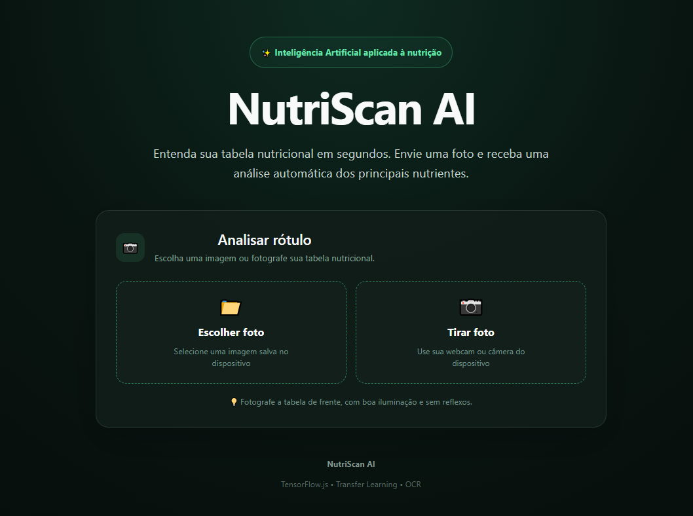
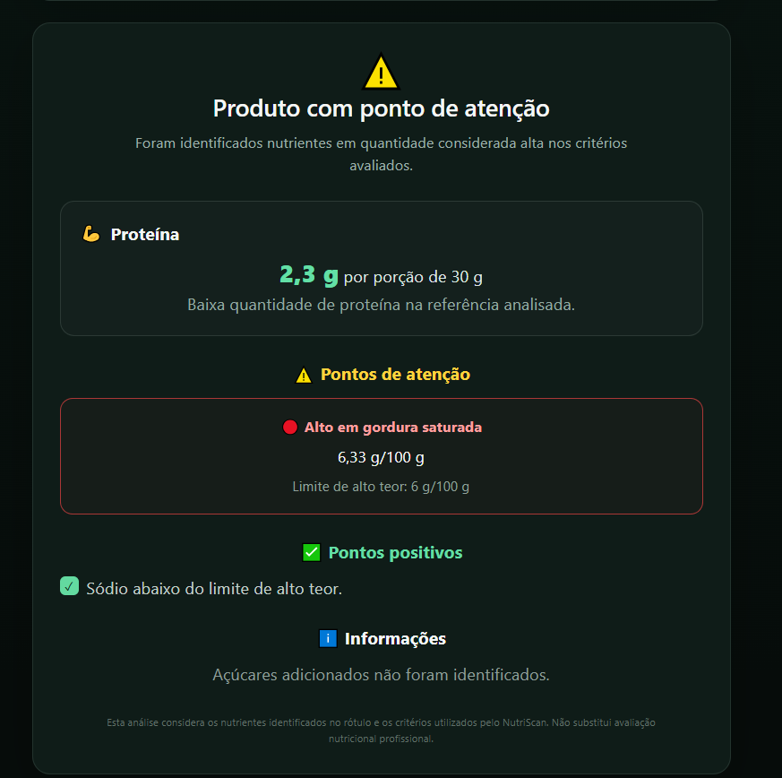
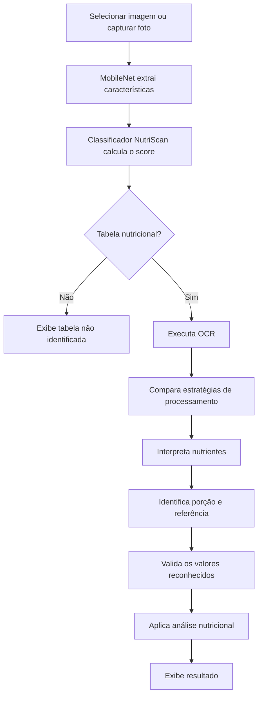

# NutriScan AI

Aplicação web para interpretar tabelas nutricionais a partir de imagens. Selecione uma foto ou capture o rótulo pela câmera para consultar os nutrientes identificados, o destaque de proteína e os pontos de atenção do produto.

O projeto combina classificação de imagens com **TensorFlow.js e MobileNet**, reconhecimento de texto com **Tesseract.js** e regras de interpretação nutricional desenvolvidas em **TypeScript**.

Todo o fluxo principal de análise acontece diretamente no navegador.

---

## Demonstração

Aplicação publicada:

```text
https://nutriscan-ai.netlify.app
```

---

## Interface

### Tela inicial

A interface permite selecionar uma imagem salva no dispositivo ou capturar uma nova foto da tabela nutricional.



### Resultado da análise

Após o processamento, o NutriScan apresenta os nutrientes identificados, destaque de proteína, pontos de atenção e informações complementares.



---

## Funcionalidades

- Seleção de imagens salvas no dispositivo.
- Captura de fotos utilizando webcam no computador.
- Captura utilizando a câmera nativa traseira em dispositivos móveis compatíveis.
- Classificação visual entre tabela nutricional e outras imagens.
- Extração automática do texto presente na tabela.
- Aplicação de diferentes estratégias de processamento para melhorar o OCR.
- Extração de energia, carboidratos, açúcares, proteínas, gorduras, fibras e sódio.
- Identificação da porção e da referência de 100 g ou 100 ml quando disponíveis.
- Validação de valores nutricionais identificados pelo OCR.
- Proteção contra valores impossíveis ou claramente inconsistentes.
- Destaque da quantidade de proteína.
- Identificação de pontos de atenção nutricional.
- Exibição de pontos positivos quando os valores analisados estão abaixo dos limites utilizados pelo projeto.
- Resultado parcial quando nem todos os nutrientes necessários são identificados.
- Solicitação de nova fotografia quando a análise não possui informações suficientes.
- Consulta ao texto extraído, confiança do OCR e score do classificador nos detalhes técnicos.

---

## Tecnologias

| Tecnologia | Uso no projeto |
| --- | --- |
| React 19 | Interface e gerenciamento de estado |
| TypeScript | Tipagem e regras de interpretação |
| Vite 8 | Servidor de desenvolvimento e build |
| TensorFlow.js 4 | Carregamento e execução do classificador |
| MobileNet | Extração de características visuais |
| Tesseract.js 7 | Reconhecimento de texto em português e inglês |
| Sharp | Preparação e transformação das imagens do dataset |
| ESLint | Verificação estática do código |
| MediaDevices API | Captura de webcam no navegador |
| Netlify | Hospedagem da aplicação |

---

## Como executar

### Pré-requisitos

- Node.js e npm instalados.
- O projeto foi validado com Node.js 24.
- Navegador moderno com suporte a JavaScript, WebAssembly e Canvas.
- Conexão à internet para recursos utilizados por bibliotecas externas quando ainda não estiverem disponíveis em cache.

Na pasta do projeto, instale as dependências:

```bash
npm ci
```

Depois execute:

```bash
npm run dev
```

Acesse o endereço exibido no terminal, normalmente:

```text
http://localhost:5173
```

No PowerShell, caso a execução de `npm.ps1` esteja bloqueada, é possível utilizar `npm.cmd`:

```bash
npm.cmd run dev
```

---

## Build de produção

Para gerar a versão de produção:

```bash
npm run build
```

O Vite gera os arquivos finais em:

```text
dist/
```

Para testar essa versão localmente:

```bash
npm run preview
```

O endereço normalmente será semelhante a:

```text
http://localhost:4173
```

A aplicação atual não possui backend próprio e não necessita de chave de API para realizar o fluxo principal de análise.

---

## Como usar

1. Abra o aplicativo no navegador.
2. Escolha uma imagem ou utilize a opção **Tirar foto**.
3. Enquadre principalmente a tabela nutricional.
4. Mantenha o rótulo de frente, com boa iluminação e sem reflexos.
5. Clique em **Analisar rótulo**.
6. Aguarde o processamento.
7. Consulte o resultado nutricional.
8. Caso queira, abra os nutrientes identificados e os detalhes técnicos.

Em dispositivos móveis, o botão **Tirar foto** utiliza preferencialmente a câmera nativa do dispositivo.

No computador, a aplicação pode utilizar a webcam diretamente pelo navegador.

Para acesso à câmera por APIs do navegador, é recomendado utilizar um contexto seguro, como HTTPS.

Fotos muito distantes, desfocadas, inclinadas, com reflexos ou com o rótulo muito curvado podem reduzir a qualidade da leitura.

---

## Fluxo de análise



O classificador utiliza o limiar definido em:

```text
src/config/modelConfig.ts
```

O valor utilizado atualmente é:

```text
0.40
```

Se o score do classificador ficar abaixo desse limite, a imagem é considerada como não sendo uma tabela nutricional e o fluxo é encerrado antes da execução do OCR.

Quando a tabela é identificada, o OCR realiza a leitura da imagem e o texto reconhecido passa pelo parser nutricional.

---

## Modelo de classificação

O classificador utilizado na aplicação fica armazenado em:

```text
public/
└── models/
    └── nutriscan-v1/
        ├── nutriscan-v1.json
        └── nutriscan-v1.weights.bin
```

O arquivo:

```text
nutriscan-v1.json
```

contém a arquitetura do classificador e o manifesto dos pesos.

O arquivo:

```text
nutriscan-v1.weights.bin
```

contém os pesos treinados da rede neural.

A aplicação carrega o modelo utilizando:

```ts
const MODEL_URL =
  `${import.meta.env.BASE_URL}models/nutriscan-v1/nutriscan-v1.json`;
```

O classificador não realiza diretamente a análise dos nutrientes.

Primeiro, a MobileNet recebe a imagem e gera um vetor de características.

Esse vetor é então enviado para o classificador NutriScan:

```text
Imagem
   ↓
MobileNet
   ↓
Embedding
   ↓
Classificador NutriScan
   ↓
Score
   ↓
Tabela nutricional
ou
Outra imagem
```

O score do classificador e a confiança retornada pelo OCR representam informações diferentes.

Uma classificação com score alto não significa que todos os números da tabela serão necessariamente reconhecidos corretamente pelo OCR.

---

## Transfer Learning

O projeto utiliza uma estratégia de **Transfer Learning**.

Em vez de treinar uma rede convolucional completa do zero, a aplicação utiliza a MobileNet como extratora de características.

O fluxo utilizado é:

```text
Imagem
   ↓
MobileNet pré-treinada
   ↓
Embedding de características
   ↓
Classificador treinado pelo projeto
   ↓
Resultado
```

Essa abordagem reduz a quantidade de dados e recursos necessários para criar o primeiro classificador do projeto.

---

## OCR

Depois que a imagem é classificada como tabela nutricional, o NutriScan utiliza **Tesseract.js** para reconhecer o texto.

O OCR trabalha principalmente com:

```text
Português
Inglês
```

A aplicação testa diferentes versões processadas da imagem para aumentar a chance de leitura.

Entre as estratégias utilizadas durante o projeto estão:

```text
Imagem original
       ↓
Escala de cinza / contraste
       ↓
Binarização
       ↓
Inversão
       ↓
Recortes auxiliares
       ↓
Comparação dos resultados
       ↓
Melhor candidato OCR
```

Cada resultado recebe uma avaliação considerando elementos esperados em uma tabela nutricional, como nomes de nutrientes, unidades e informações de porção.

---

## Parser nutricional

Depois do OCR, o texto reconhecido passa pelo:

```text
src/services/nutritionParser.ts
```

O parser tenta identificar os principais nutrientes da tabela.

Atualmente são processados:

- valor energético;
- carboidratos;
- açúcares totais;
- açúcares adicionados;
- proteínas;
- gorduras totais;
- gorduras saturadas;
- gorduras trans;
- fibra alimentar;
- sódio;
- sal;
- valor da porção;
- unidade da porção.

O parser também possui correções específicas para erros comuns produzidos pelo OCR.

---

## Correções de OCR

Alguns caracteres podem ser confundidos durante a leitura.

Um exemplo comum identificado durante o desenvolvimento foi a letra:

```text
g
```

ser reconhecida como:

```text
9
```

Isso pode produzir leituras como:

```text
21g
```

sendo reconhecido como:

```text
219
```

O parser possui regras contextuais capazes de interpretar alguns desses casos como:

```text
219
↓
21 g
```

Outro exemplo:

```text
4,3g
```

pode aparecer no OCR como:

```text
4.39
```

Dependendo do contexto da linha, o sistema consegue corrigir para:

```text
4.3 g
```

Essas correções são aplicadas considerando o nutriente, a unidade esperada e a estrutura da linha reconhecida.

---

## Validação dos valores

O NutriScan possui uma camada adicional de validação para reduzir o risco de apresentar valores nutricionais impossíveis.

Exemplo:

```text
Porção: 30 g

OCR:

Proteína: 2089 g
```

Uma porção de 30 g não pode possuir 2089 g de proteína.

Nesse caso, o valor é descartado.

O sistema prefere apresentar:

```text
Não identificado
```

em vez de utilizar um valor claramente inconsistente.

Também são realizadas verificações quando a tabela possui referência de:

```text
100 g
```

Nessa situação, um nutriente individual em gramas não pode ultrapassar 100 g para essa referência.

---

## Análise nutricional

Depois que os nutrientes são extraídos e validados, os dados são enviados para:

```text
src/services/nutritionAnalysis.ts
```

Essa etapa gera uma interpretação simplificada das informações reconhecidas.

Os possíveis estados incluem:

```text
✅ Perfil nutricional favorável

⚠️ Produto com ponto de atenção

⚠️ Produto com vários pontos de atenção

🟡 Análise parcial

📷 Análise incompleta
```

A análise considera principalmente:

- açúcares adicionados;
- gordura saturada;
- sódio;
- proteína identificada;
- disponibilidade das informações necessárias.

Quando não existem informações suficientes para gerar uma conclusão, o NutriScan solicita uma nova fotografia.

---

## Referência nutricional

Quando a tabela apresenta valores por:

```text
100 g
```

ou:

```text
100 ml
```

esses dados podem ser utilizados diretamente na análise.

Quando apenas uma porção é identificada, por exemplo:

```text
Porção: 30 g
```

o sistema pode calcular uma referência proporcional para 100 g.

Exemplo:

```text
Gordura saturada:

1,9 g em 30 g
```

Normalização:

```text
1,9 / 30 × 100
```

Resultado aproximado:

```text
6,33 g / 100 g
```

Essa referência permite comparar o valor com os limites utilizados pela análise.

---

## Pontos de atenção

O NutriScan verifica atualmente três nutrientes principais para geração de alertas.

### Produtos sólidos — referência por 100 g

```text
Açúcares adicionados:
15 g / 100 g

Gordura saturada:
6 g / 100 g

Sódio:
600 mg / 100 g
```

### Produtos líquidos — referência por 100 ml

```text
Açúcares adicionados:
7,5 g / 100 ml

Gordura saturada:
3 g / 100 ml

Sódio:
300 mg / 100 ml
```

Quando um valor atinge ou ultrapassa o limite utilizado pelo projeto, um ponto de atenção é exibido.

Exemplo:

```text
⚠️ Pontos de atenção

🔴 Alto em gordura saturada

6,33 g / 100 g

Limite de alto teor:
6 g / 100 g
```

---

## Proteína

O NutriScan possui uma área específica para apresentar a quantidade de proteína reconhecida.

Exemplo:

```text
Proteína

2,3 g por porção de 30 g
```

O projeto também apresenta uma interpretação simples da quantidade encontrada.

Essa interpretação é utilizada apenas como informação dentro do projeto e não representa diagnóstico nutricional ou recomendação profissional.

---

## Pontos positivos

Quando um nutriente analisado permanece abaixo do limite de alto teor utilizado pelo sistema, o NutriScan pode apresentar esse resultado como informação positiva.

Exemplo:

```text
✅ Pontos positivos

✓ Sódio abaixo do limite de alto teor.
```

---

## Resultados parciais

Nem todas as tabelas possuem exatamente o mesmo formato.

Além disso, o OCR pode não conseguir identificar todos os nutrientes.

Por isso o NutriScan diferencia resultados completos de resultados parciais.

Exemplo:

```text
Açúcares adicionados:
Não identificado
```

O sistema não tenta inventar esse valor nem substituí-lo pelos açúcares totais.

Quando faltam dados importantes, o resultado pode ser classificado como parcial ou insuficiente.

---

## Câmera

O NutriScan suporta dois fluxos diferentes de captura.

### Desktop

Em computadores, a webcam pode ser acessada utilizando:

```ts
navigator.mediaDevices.getUserMedia()
```

A câmera é exibida dentro da própria interface e o usuário pode capturar a fotografia.

### Mobile

Em dispositivos móveis, o botão de câmera utiliza preferencialmente a captura nativa:

```html
<input
  type="file"
  accept="image/*"
  capture="environment"
/>
```

Essa abordagem permite utilizar melhor a câmera traseira do aparelho e tende a oferecer:

- melhor foco;
- maior resolução;
- melhor processamento da câmera;
- melhor orientação da fotografia.

O comportamento exato pode variar de acordo com o navegador e o sistema operacional.

---

## Estrutura do projeto

```text
nutriscan-ai/
│
├── docs/
│   └── screenshots/
│       ├── home.png
│       └── resultado.png
│
├── public/
│   └── models/
│       └── nutriscan-v1/
│           ├── nutriscan-v1.json
│           └── nutriscan-v1.weights.bin
│
├── scripts/
│   ├── prepare-dataset.mjs
│   ├── augment-dataset.mjs
│   └── export-training-data.mjs
│
├── src/
│   ├── assets/
│   │
│   ├── config/
│   │   └── modelConfig.ts
│   │
│   ├── services/
│   │   ├── evaluation.ts
│   │   ├── nutritionAnalysis.ts
│   │   ├── nutritionParser.ts
│   │   ├── nutriscan.ts
│   │   ├── ocr.ts
│   │   └── training.ts
│   │
│   ├── App.tsx
│   ├── App.css
│   └── main.tsx
│
├── package.json
├── tsconfig.json
└── vite.config.ts
```

---

## Dataset e treinamento

O repositório possui serviços e scripts utilizados durante a criação e avaliação do classificador.

Esses recursos são separados da utilização normal da aplicação.

O usuário final utiliza diretamente o modelo estático disponível em:

```text
public/models/nutriscan-v1/
```

O conjunto de dados utilizado durante o desenvolvimento foi organizado em classes simplificadas:

```text
nutrition-label
other
```

O objetivo do classificador é diferenciar imagens que representam tabelas nutricionais das demais imagens.

---

## Preparação do dataset

Os scripts de preparação trabalham com dados armazenados localmente em:

```text
dataset/
```

Os conjuntos podem ser organizados entre:

```text
train
valid
test
```

com anotações no formato COCO.

Para preparar os dados:

```bash
node scripts/prepare-dataset.mjs
```

Para gerar os dados utilizados pelo treinamento no navegador:

```bash
node scripts/export-training-data.mjs
```

A exportação pode gerar:

```text
public/
└── training-data/
    └── manifest.json
```

junto das imagens preparadas utilizadas durante treinamento e avaliação.

---

## Data augmentation

O projeto também possui um script experimental para geração de variações das imagens de treinamento:

```bash
node scripts/augment-dataset.mjs
```

Essas variações podem ser utilizadas em experimentos futuros para aumentar a diversidade das imagens disponíveis.

---

## Configuração da V1

A versão utilizada no projeto foi treinada com uma configuração determinística para melhorar a reprodução dos resultados.

Configuração principal:

```text
Seed:
42

Imagens de treinamento por classe:
100

Imagens de validação por classe:
30

Epochs:
30

Batch size:
16

Optimizer:
Adam

Learning rate:
0.001
```

---

## Avaliação do classificador

A V1 obteve os seguintes resultados no conjunto utilizado durante a avaliação:

| Métrica | Resultado |
| --- | ---: |
| Accuracy | 89,90% |
| Precision | 89,47% |
| Recall | 92,73% |
| F1-score | 91,07% |
| Falsos positivos | 6 |
| Falsos negativos | 4 |

Essas métricas representam o desempenho do classificador no conjunto de avaliação utilizado durante o desenvolvimento e não significam que o sistema terá a mesma precisão para qualquer imagem encontrada fora desse conjunto.

---

## IndexedDB e modelo de produção

Durante o treinamento, o classificador é salvo no IndexedDB do navegador.

Exemplo:

```text
indexeddb://nutriscan-classifier-v1
```

Esse armazenamento é utilizado durante desenvolvimento e treinamento.

Para produção, o modelo foi exportado para arquivos TensorFlow.js:

```text
nutriscan-v1.json
nutriscan-v1.weights.bin
```

Esses arquivos foram adicionados ao projeto em:

```text
public/models/nutriscan-v1/
```

Assim, o usuário final pode utilizar o NutriScan sem executar o treinamento.

---

## Arquivos ignorados pelo Git

Dados de treinamento e arquivos temporários não precisam fazer parte do repositório principal.

Entre os diretórios ignorados estão:

```text
dataset/
public/training-data/
node_modules/
dist/
```

Por isso, para repetir completamente o treinamento, é necessário possuir ou gerar localmente os dados correspondentes.

---

## Verificações

Antes da publicação, é recomendado executar:

```bash
npm run lint
```

e:

```bash
npm run build
```

Para testar a versão final:

```bash
npm run preview
```

Além dos testes automatizados disponíveis no projeto, a aplicação também deve ser validada com fotografias reais, especialmente em dispositivos móveis.

---

## Deploy

O NutriScan é uma aplicação front-end estática.

Para gerar os arquivos de produção:

```bash
npm run build
```

Depois disso, o conteúdo de:

```text
dist/
```

pode ser publicado em plataformas como:

- Netlify;
- Vercel;
- Cloudflare Pages.

A versão atual foi preparada para publicação no **Netlify**.

Como o acesso à câmera pelo navegador possui restrições de segurança, a aplicação deve preferencialmente ser disponibilizada utilizando **HTTPS**.

---

## Limitações

O NutriScan é um projeto experimental e ainda possui limitações.

Entre elas:

- O reconhecimento depende da qualidade da fotografia.
- Reflexos podem dificultar o OCR.
- Imagens desfocadas podem impedir a leitura dos nutrientes.
- Texto muito pequeno pode reduzir a precisão.
- Tabelas inclinadas podem prejudicar a extração.
- Rótulos curvos podem produzir distorções.
- Diferentes fabricantes podem utilizar estruturas visuais diferentes.
- Nem todos os erros do OCR podem ser corrigidos automaticamente.
- Valores não reconhecidos podem resultar em análise parcial.
- A primeira análise pode demorar mais devido ao carregamento das bibliotecas e modelos.
- O desempenho depende do dispositivo e do navegador.

Quando um valor não é reconhecido com segurança, o sistema prefere não utilizá-lo.

---

## Próximos passos

Possíveis evoluções do projeto:

- ampliar o dataset;
- adicionar mais tabelas nutricionais brasileiras;
- melhorar o classificador;
- treinar com maior diversidade de condições de iluminação;
- detectar automaticamente a região da tabela;
- recortar a tabela antes do OCR;
- corrigir perspectiva automaticamente;
- melhorar tratamento de rótulos curvos;
- melhorar detecção de orientação;
- criar histórico das análises;
- permitir comparação entre produtos;
- transformar a aplicação em PWA;
- permitir instalação no celular;
- melhorar os testes automatizados;
- estudar novos modelos de visão computacional para detecção da tabela.

---

## Aprendizados

O desenvolvimento do NutriScan envolveu diferentes etapas de Inteligência Artificial e Engenharia de Software.

Entre os principais temas estudados estão:

```text
Machine Learning
Deep Learning
Transfer Learning
TensorFlow.js
MobileNet
Computer Vision
OCR
Processamento de imagens
Validação de dados
React
TypeScript
Deploy de modelos de Machine Learning
Captura de câmera no navegador
```

Um dos principais aprendizados durante o projeto foi perceber que uma aplicação de Inteligência Artificial não termina no treinamento do modelo.

O fluxo completo envolve:

```text
Dataset
   ↓
Preparação dos dados
   ↓
Treinamento
   ↓
Avaliação
   ↓
Exportação do modelo
   ↓
Entrada do usuário
   ↓
Classificação
   ↓
OCR
   ↓
Interpretação
   ↓
Validação
   ↓
Análise
   ↓
Interface
   ↓
Deploy
```

---

## Aviso

O **NutriScan AI** é um projeto educacional e experimental.

As informações apresentadas dependem da qualidade da imagem e da interpretação automática realizada pelo OCR.

Erros de reconhecimento podem ocorrer.

Os resultados possuem caráter informativo e não substituem avaliação, orientação ou acompanhamento realizado por nutricionista ou outro profissional de saúde habilitado.

Sempre confira as informações diretamente no rótulo original do produto.

---

## Autora

**Flávia Ferrari**

Desenvolvedora com foco em desenvolvimento de software, inovação e aplicação prática de Inteligência Artificial em sistemas.

Projeto desenvolvido como parte dos estudos e aprofundamento em **Engenharia de Inteligência Artificial Aplicada**.

---

## NutriScan AI

> Transformando uma fotografia de uma tabela nutricional em informações mais fáceis de interpretar utilizando Inteligência Artificial.